  <picture>
    <source media="(prefers-color-scheme: dark)" srcset="assets/header.svg" />
    <source media="(prefers-color-scheme: light)" srcset="assets/light/header.svg" />
    
  </picture>

  <picture>
    <source media="(prefers-color-scheme: dark)" srcset="assets/title-about.svg" />
    <source media="(prefers-color-scheme: light)" srcset="assets/light/title-about.svg" />
    
  </picture>

  <picture>
    <source media="(prefers-color-scheme: dark)" srcset="assets/about.svg" />
    <source media="(prefers-color-scheme: light)" srcset="assets/light/about.svg" />
    
  </picture>

  <picture>
    <source media="(prefers-color-scheme: dark)" srcset="assets/title-focus.svg" />
    <source media="(prefers-color-scheme: light)" srcset="assets/light/title-focus.svg" />
    
  </picture>

  <picture>
    <source media="(prefers-color-scheme: dark)" srcset="assets/focus.svg" />
    <source media="(prefers-color-scheme: light)" srcset="assets/light/focus.svg" />
    
  </picture>

  <picture>
    <source media="(prefers-color-scheme: dark)" srcset="assets/title-workflow.svg" />
    <source media="(prefers-color-scheme: light)" srcset="assets/light/title-workflow.svg" />
    
  </picture>

  <picture>
    <source media="(prefers-color-scheme: dark)" srcset="assets/workflow.svg" />
    <source media="(prefers-color-scheme: light)" srcset="assets/light/workflow.svg" />
    
  </picture>

  <picture>
    <source media="(prefers-color-scheme: dark)" srcset="assets/builds.svg" />
    <source media="(prefers-color-scheme: light)" srcset="assets/light/builds.svg" />
    
  </picture>

  <picture>
    <source media="(prefers-color-scheme: dark)" srcset="assets/title-connect.svg" />
    <source media="(prefers-color-scheme: light)" srcset="assets/light/title-connect.svg" />
    
  </picture>

  <a href="https://www.linkedin.com/in/victor-herculini"><picture><source media="(prefers-color-scheme: dark)" srcset="assets/connect-linkedin.svg" /><source media="(prefers-color-scheme: light)" srcset="assets/light/connect-linkedin.svg" /></picture></a>
  <a href="mailto:vrherculini@gmail.com"><picture><source media="(prefers-color-scheme: dark)" srcset="assets/connect-email.svg" /><source media="(prefers-color-scheme: light)" srcset="assets/light/connect-email.svg" /></picture></a>
  <a href="https://www.instagram.com/victorherculini/"><picture><source media="(prefers-color-scheme: dark)" srcset="assets/connect-instagram.svg" /><source media="(prefers-color-scheme: light)" srcset="assets/light/connect-instagram.svg" /></picture></a>

  <picture>
    <source media="(prefers-color-scheme: dark)" srcset="assets/footer.svg" />
    <source media="(prefers-color-scheme: light)" srcset="assets/light/footer.svg" />
    
  </picture>

